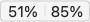
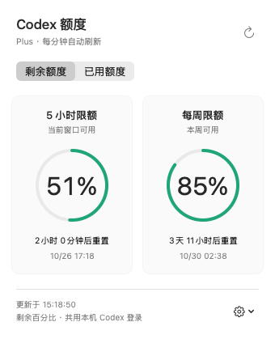

# Codex Quota Bar

在 Mac 菜单栏查看 Codex **5 小时 / 每周剩余额度**，点击即可查看详情和重置时间。

**[下载安装包](https://github.com/zheng-dada/codex-quota-bar/releases)** · macOS 13+ · Apple 芯片（M 系列）

## 界面预览

菜单栏：**左边是 5 小时，右边是每周**，默认显示剩余百分比。



点击数值，展开额度面板：



<sub>以上为当前源码渲染的界面截图，数值为示例。</sub>

## 三步开始使用

1. **登录 Codex**：在这台 Mac 上安装 Codex 桌面端或 CLI，并使用自己的 ChatGPT 账户登录。
2. **安装工具**：在 [Releases](https://github.com/zheng-dada/codex-quota-bar/releases) 的 **Assets** 中下载 `CodexQuotaBar-macOS-arm64.zip`，解压后将 `Codex Quota Bar.app` 拖入「应用程序」。
3. **打开应用**：双击启动，在屏幕顶部菜单栏查看额度。无需填写 Token 或 API Key。

> 当前安装包仅支持 Apple 芯片 Mac。应用未做 Apple 公证；若首次打开提示无法验证开发者，确认下载来源可信后，到「系统设置 → 隐私与安全性 → 仍要打开」。[Apple 操作说明](https://support.apple.com/zh-cn/102445)

## 怎么用

| 想做什么 | 操作 |
| --- | --- |
| 查看额度和重置时间 | 点击菜单栏的两个百分比 |
| 切换显示方式 | 点击面板中的「剩余额度 / 已用额度」 |
| 立即更新 | 点击面板右上角刷新按钮；平时每分钟自动刷新 |
| 开机自动运行 | 点击右下角齿轮 →「登录时启动」 |
| 退出应用 | 点击右下角齿轮 →「退出 Codex Quota Bar」 |

菜单栏数值在 **10%–20% 时显示黄色，低于 10% 时显示红色**。默认模式下，数值越低，剩余额度越少。

## 常见问题

**打开后没有窗口？** 这是菜单栏应用，直接看屏幕顶部，不会显示 Dock 图标。

**显示 `—` 或找不到 Codex？** 先确认 Codex 已登录，再点击刷新。若仍找不到，点击齿轮 →「选择 Codex 可执行文件…」，选择本机的 `codex` 程序。账户未提供的额度窗口会显示 `—`；API Key 登录不提供这里的订阅额度。

**数值旁出现 `!`？** 表示刷新失败或重置时间已到、数据待同步。检查网络后重试，面板会保留上次数据并显示更新时间。

**如何卸载？** 先关闭「登录时启动」，退出后删除应用。

## 账户与隐私

共用本机 Codex 登录，通过本机 Codex CLI 查询账户额度。不读取或复制登录令牌，不保存额度到磁盘，也不发起模型对话。若额度与桌面端不同，请确认两者使用相同账户和 `CODEX_HOME`。

这是独立开发的本地工具，非 OpenAI 官方应用。

<details>
<summary>开发者：从源码构建</summary>

需要 Apple Command Line Tools（`xcode-select --install`），无需 npm 或第三方依赖。

```bash
git clone https://github.com/zheng-dada/codex-quota-bar.git
cd codex-quota-bar
bash test.sh
bash build.sh
open "dist/Codex Quota Bar.app"
```

应用生成在 `dist/`，按当前 Mac 的架构编译，使用本地 ad-hoc 签名。测试使用模拟服务，不访问真实账户。

仅诊断连接和额度：

```bash
"dist/Codex Quota Bar.app/Contents/MacOS/CodexQuotaBar" --check
```

</details>
